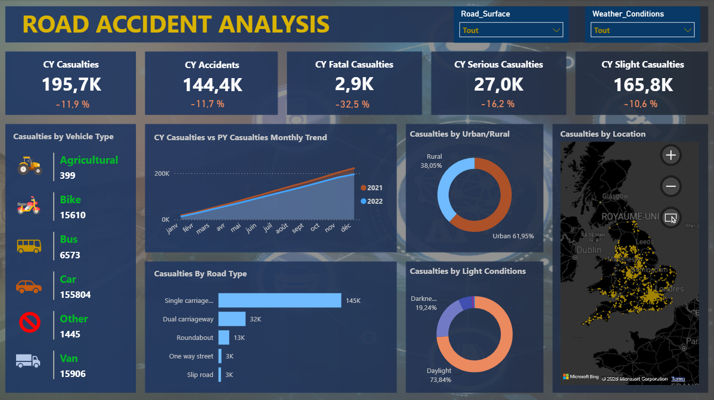

# Road Accident Analysis – Power BI Dashboard

Interactive Power BI dashboard analysing road accidents and casualties in 2021 and 2022. 

## Objective
Turn raw road accident data into clear, actionable insights for road safety stakeholders: understand how casualties and accidents evolve, identify the most dangerous vehicle types, road types, areas and conditions, and support prevention and policy decisions.

## Requirements
The client wanted a dashboard covering 2021 and 2022 with:
1. **Primary KPI** – total casualties and total accidents for the current year, with year-over-year (YoY) growth.
2. **Primary KPI (severity)** – casualties by accident severity (fatal, serious, slight) for the current year, with YoY growth.
3. **Secondary KPI** – casualties by vehicle type for the current year.
4. **Monthly trend** – monthly casualties, current year vs previous year.
5. **Casualties by road type** – distribution for the current year.
6. **Casualties by area and time of day** – urban vs rural, day vs night.
7. **Casualties and accidents by location** – geographic map.

## Dashboard content
### 1. Key Performance Indicators (2022 vs 2021)
| KPI | Result |
|---|---|
| Total casualties | −11.9 % YoY |
| Total accidents | −11.7 % YoY |
| Fatal casualties | 2.9K (−33.3 %) |
| Serious casualties | 27K (−16.2 %) |
| Slight casualties | 165.8K (−10.6 %) |

### 2. Casualties by vehicle type
| Vehicle | Casualties |
|---|---|
| Cars | 155,804 |
| Vans | 15,905 |
| Motorcycles | 15,610 |
| Buses | 6,573 |
| Other | 1,446 |
| Agricultural | 399 |

### 3. Other breakdowns
| Visual | Highlights |
|---|---|
| Monthly trend | Casualties per month, 2021 vs 2022, to spot seasonal patterns |
| Urban / Rural | Urban 61.95 %, Rural 38.05 % |
| Road type | Single carriageway 145K, Dual carriageway 32K, Roundabout 13K, One way street 3K, Slip road 3K |
| Light conditions | Day 73.84 %, Night 26.16 % |
| Location map | Accidents and casualties by geographic location |

## Key takeaways
- Casualties (−11.9 %) and accidents (−11.7 %) both fell in 2022; fatal casualties dropped the most (−33.3 %).
- Cars account for the vast majority of casualties (about 156K), far ahead of vans and motorcycles.
- Urban areas concentrate about 62 % of casualties versus 38 % in rural areas.
- Single carriageways are by far the most dangerous road type (145K casualties).
- Nearly three quarters of accidents (73.84 %) happen in daylight.

## Data
Road accident dataset with the main columns:
- `Accident_Index` – unique accident identifier
- `Accident Date` – date of the accident (day-month-year)
- `Day_of_Week` – day of the week
- `Junction_Control` / `Junction_Detail` – junction control type and layout
- `Accident_Severity` – Fatal, Serious or Slight
- `Latitude` / `Longitude` – coordinates, used for the map
- `Light_Conditions` – daylight or darkness
- `Local_Authority_(District)` – district, for regional analysis
- `Carriageway_Hazards` – hazards on the road

## Project steps
1. Requirements gathering
2. Stakeholders identification
3. Raw data overview
4. Connecting data to Power BI
5. Data cleaning (missing values, standardisation)
6. Data processing and transformations
7. Data modelling (relationships between tables)
8. Background design in PowerPoint (`images/Background.pptx`)
9. Data visualisation
10. Report / dashboard creation
11. Insights

## How to open
1. Install [Power BI Desktop](https://powerbi.microsoft.com/desktop/) (Windows).
2. Download `Road Accident Analysis.pbix`.
3. Open it in Power BI Desktop.

## Tools
Power BI Desktop · Power Query · DAX · PowerPoint (background design)
